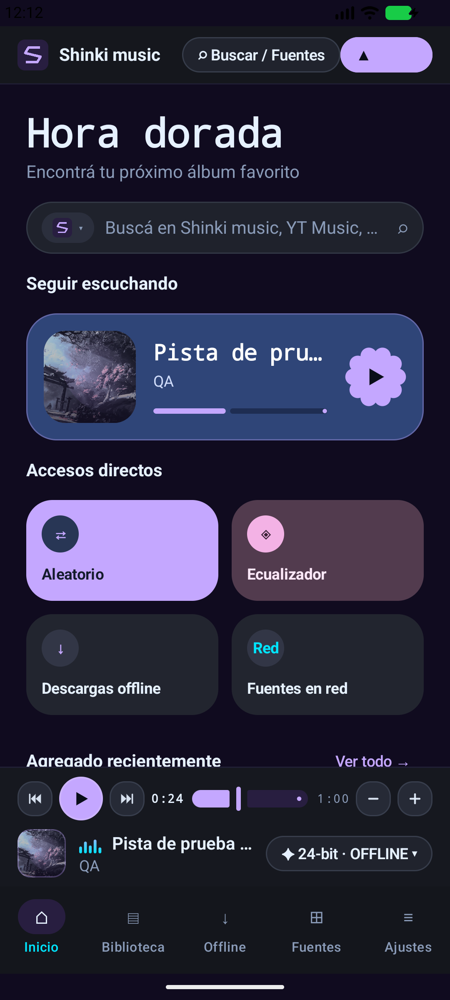

# Shinki music


**Un reproductor de música personal, de código abierto y sin anuncios, creado por JadenYuki4.** Buscá música en YouTube Music, YouTube, SoundCloud o Bandcamp, armá tu cola y retomá la escucha donde la dejaste. Shinki comparte la interfaz entre Android, Windows y Linux, y usa un motor de audio nativo en cada plataforma.

**Aurora 5.3.4** · [Descargar para Android](https://github.com/JadenYuki4/Shinki-music/releases/download/v5.3.4/Shinki-music-5.3.4.apk) · [Descargar para Windows x64](https://github.com/JadenYuki4/Shinki-music/releases/download/v5.3.4/Shinki-music-5.3.4.msi) · [Ver todas las versiones](https://github.com/JadenYuki4/Shinki-music/releases)

## Escuchar a tu manera

- **Seguir escuchando.** Al volver a abrir Shinki, la última canción aparece en pausa en el punto guardado. Tocá Reproducir para continuar. La cola admite reproducción aleatoria, repetición y temporizador de sueño.
- **Descubrir música.** Las búsquedas, escuchas y canciones que marcás con Me gusta alimentan las recomendaciones locales. En Ajustes podés elegir artistas favoritos, pedir menos sugerencias o bloquear artistas, grupos y géneros. Podés quitar las reglas cuando quieras. El filtro de género usa el texto disponible en el título o en la búsqueda.
- **Organizar tu biblioteca.** «Agregado recientemente» reúne tus últimos 12 Me gusta. Podés guardar canciones para escuchar sin conexión, crear listas locales, respaldarlas en JSON o intercambiarlas en M3U8.
- **Controlar el sonido.** El reproductor incluye ecualizador, velocidad y letras sincronizadas cuando están disponibles. Android ofrece reproducción en segundo plano y controles en la pantalla de bloqueo. En escritorio tenés teclas multimedia y bandeja del sistema.
- **Actualizar la app.** En Ajustes, **Buscar actualizaciones** consulta la última versión pública de GitHub. **Ver descarga** abre la página donde elegís el instalador. **Copiar diagnóstico** reúne la versión y los datos técnicos para informar un problema.

## Diseño



Shinki usa fondos oscuros, acentos violeta y cian y títulos geométricos. En el teléfono, la navegación queda abajo y el minirreproductor sigue a mano mientras explorás. En escritorio, la barra lateral deja espacio para la biblioteca y un panel de cola o letras. **Violet Void**, **Neon Cyan** y **Monochrome Light** son algunas de las paletas disponibles. En Ajustes podés regular el resplandor, la animación y el redondeo, o activar el modo de bajo consumo. Los cambios de apariencia se aplican a la sesión.

La distribución del escritorio toma como referencia a [Limusic](https://github.com/SimoHypers/limusic/releases/tag/v1.3.0). Los créditos de los componentes y diseños adaptados están en [NOTICE.md](NOTICE.md).

## Herramientas

| Parte del reproductor | Tecnología y función |
| --- | --- |
| Interfaz y lógica compartidas | Kotlin Multiplatform y Compose Multiplatform para pantallas, estado y controles. |
| Fuentes de música | NewPipe Extractor detrás de la interfaz `MusicSource`, que separa los proveedores de las pantallas. |
| Audio en Android | Media3 y ExoPlayer con un servicio de reproducción y una sesión multimedia. |
| Audio en escritorio | libmpv integrado desde la JVM mediante JNA. |
| Datos locales | SQLDelight con SQLite para la biblioteca y el historial. Multiplatform Settings para preferencias y sesión. |
| Arquitectura y distribución | Koin para inyección de dependencias, corutinas y Flow para el estado. Gradle y GitHub Actions para compilar. R8 reduce el APK y jlink recorta el entorno Java de escritorio. |

## Compilar desde el código

Usá un **JDK 21 completo** como `JAVA_HOME` y el **SDK de Android 37**. Android admite dispositivos desde API 26. El instalador de Windows incluye su propio entorno Java. La publicación de Aurora 5.3.4 ofrece APK y MSI. Para Linux podés compilar desde el código.

**Android** · En Windows, con un teléfono o emulador conectado:

```powershell
.\gradlew.bat :androidApp:assembleDebug :androidApp:installDebug
```

Para generar la variante optimizada usá `:androidApp:assembleRelease`. Gradle deja el APK sin firmar en `androidApp/build/outputs/apk/release/`. El APK publicado ya está firmado.

**Windows 10/11 x64** · Prepará libmpv, ejecutá el reproductor o generá el MSI:

```powershell
.\scripts\prepare-libmpv.ps1
.\gradlew.bat :desktopApp:run
.\gradlew.bat :desktopApp:packageMsi
```

El instalador se genera en `desktopApp/build/shinki-music-dist/main/msi/`.

**Linux** · En una distribución compatible con estos paquetes:

```sh
sudo apt install libmpv2 python3-gi gir1.2-glib-2.0 fakeroot
bash gradlew :desktopApp:run
bash gradlew :desktopApp:packageDeb
```

**Pruebas** · Ejecutá `.\gradlew.bat :shared:jvmTest :shared:testAndroidHostTest :desktopApp:test` para la lógica compartida, Android host y escritorio. Con un dispositivo Android conectado, usá `:androidApp:connectedDebugAndroidTest`.

## Documentación y ediciones

- [Arquitectura y estructura](docs/ARCHITECTURE.md) · [Dependencias y versiones](docs/DEPENDENCIES.md)
- [Fuentes e historial](docs/PHASE_B.md) · [Motores de audio](docs/PHASE_C.md) · [Biblioteca y recomendaciones](docs/PHASE_D.md)
- [Referencia de diseño](docs/DESIGN_REFERENCE.md) · [Validación y rendimiento](docs/VALIDATION.md)

| Edición | Versión |
| --- | --- |
| Origen | 1.0, versión inicial de Android |
| Pulso | 5.2.7 |
| Órbita | 5.2.8 |
| Aurora | 5.3.0, compilación 168 |
| Aurora · reanudación de sesión | 5.3.1, compilación 169 |
| Aurora · reproducción y cola automática | 5.3.3, compilación 171 |
| Aurora · icono de Shinki music | 5.3.4, compilación 172 |

## Licencia y uso

Proyecto personal y educativo bajo [GPL-3.0-or-later](LICENSE). El acceso a YouTube Music mediante un cliente de terceros puede incumplir los términos de servicio de YouTube. Shinki es independiente de YouTube y Google. No permite eludir DRM, obtener credenciales ni saltarse suscripciones de pago. Los componentes de terceros conservan sus licencias y atribuciones. [Créditos](NOTICE.md)
